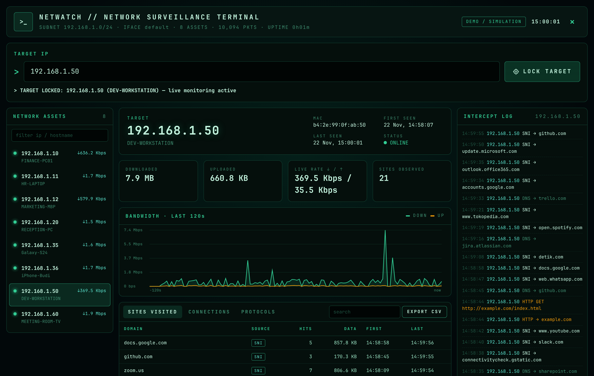
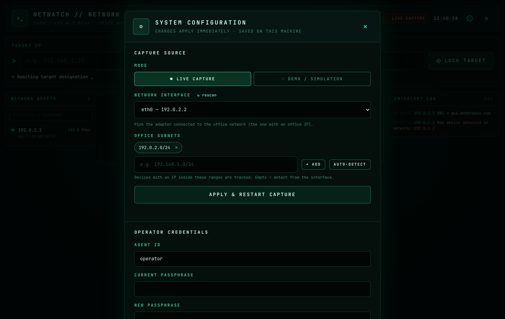

# NETWATCH — Terminal Pemantau Jaringan Kantor

Dashboard bergaya "secure terminal" untuk memantau perangkat di jaringan kantor:
cukup masukkan **IP address** perangkat untuk melihat pemakaian bandwidth, situs yang
dibuka, koneksi aktif, dan protokol yang dipakai, secara live.



## Apa yang bisa dilihat

| Data | Sumber | Keterangan |
|---|---|---|
| Upload / download per perangkat, grafik 120 detik | Semua paket IP | Akurat |
| **Situs yang dibuka (domain)** | TLS SNI, DNS query, HTTP Host | Contoh: `www.youtube.com`, `mail.google.com` |
| URL lengkap | HTTP biasa (`http://`) saja | Situs HTTPS hanya terlihat domainnya; isi halaman & path terenkripsi |
| Koneksi (IP:port tujuan, layanan, volume) | Header TCP/UDP | Dipetakan ke domain lewat jawaban DNS |
| Protokol (HTTPS, QUIC, DNS, SSH, RDP, VPN…) | Port | |
| MAC address, hostname | Ethernet, DHCP, reverse DNS | |
| Log intercept real-time | Semua di atas | |

Fitur lain: daftar semua aset di jaringan, export CSV riwayat situs per perangkat,
login operator (sesi tidak disimpan, kunci 5 menit setelah 5x gagal).

## Syarat penting: posisi komputer pemantau

Aplikasi ini **hanya bisa melihat lalu lintas yang benar-benar melewati kartu jaringan
komputer tempat ia berjalan**. Di jaringan switch biasa, PC biasa hanya melihat trafiknya
sendiri. Pilih salah satu:

1. **Port mirroring / SPAN** (disarankan) — di managed switch, mirror port uplink ke router
   ke port tempat komputer NETWATCH dicolok.
2. **Jalankan di gateway** — mini PC Linux yang menjadi router/gateway kantor.
3. **Router yang bisa mirror trafik** — misalnya MikroTik *Packet Sniffer → streaming* /
   *mangle action=sniff-tzsp* ke komputer NETWATCH, atau OpenWrt dengan port mirror.

> Bila browser memakai **DNS-over-HTTPS** atau **VPN**, domain via DNS tidak terlihat
> (SNI biasanya masih terlihat, kecuali VPN). Matikan DoH via kebijakan browser/GPO
> dan blokir VPN pribadi bila ingin data lengkap.

## Instalasi (Windows)

1. Install **Python 3.13** (`winget install -e --id Python.Python.3.13`) dan [Npcap](https://npcap.com)
   (centang *WinPcap API-compatible mode*).
2. Sekali saja, di folder ini:
   ```powershell
   py -3.13 -m pip install -r requirements.txt pywebview
   ```
3. Double-click **`NETWATCH.bat`** → izinkan Administrator → jendela NETWATCH terbuka.

Linux/macOS: `pip install -r requirements.txt` lalu `sudo python3 -m netwatch`.

## Semua diatur dari aplikasi



- **Pertama kali dibuka**: layar login meminta Anda **membuat Agent ID & passphrase** operator.
- Ikon **⚙ (Settings)** di kanan atas:
  - **Mode**: LIVE CAPTURE atau DEMO / SIMULATION
  - **Network interface**: pilih dari daftar adapter (Wi-Fi, Ethernet, …) beserta IP-nya
  - **Office subnets**: tambah/hapus, atau **AUTO-DETECT** dari interface terpilih
  - **APPLY & RESTART CAPTURE**: langsung berlaku, tanpa restart aplikasi
  - Ganti Agent ID / passphrase, dan hapus semua data yang terkumpul
- Jika capture gagal (bukan Administrator, Npcap belum terpasang, interface salah), muncul
  peringatan merah dengan tombol **OPEN SETTINGS**.

Pengaturan disimpan di `%USERPROFILE%\.netwatch\config.json` (passphrase disimpan sebagai
hash PBKDF2). Lupa passphrase? Hapus file itu, lalu buka NETWATCH untuk membuat akun baru.

**Jendela aplikasi**: NETWATCH membuka jendela native (pywebview/WebView2). Bila pywebview
tidak tersedia, otomatis memakai jendela Edge app mode (tanpa tab & address bar).
Menutup jendela = menghentikan NETWATCH.

### Opsi command line (opsional)

| Opsi | Fungsi |
|---|---|
| `--demo` | Mulai dalam mode demo (sementara, tidak disimpan) |
| `--iface NAME` / `--subnet CIDR` | Timpa pengaturan untuk sesi ini |
| `--no-window` | Jalankan server saja, buka `http://127.0.0.1:8787` sendiri |
| `--host` / `--port` | Alamat dashboard (default `127.0.0.1:8787`) |

## Catatan hukum & etika

Memantau trafik karyawan menyentuh data pribadi. Di Indonesia, UU No. 27/2022 tentang
Pelindungan Data Pribadi berlaku. Pastikan ada **kebijakan tertulis penggunaan
jaringan kantor** yang diketahui karyawan, pantau hanya perangkat/jaringan milik
perusahaan, batasi akses dashboard ke admin yang berwenang, dan jangan simpan data lebih
lama dari yang diperlukan (NETWATCH menyimpan data di memori saja; hilang saat restart).

## Struktur

```
netwatch/
  netwatch/server.py    # HTTP server, API JSON, login
  netwatch/config.py    # pengaturan tersimpan + deteksi interface
  netwatch/engine.py    # start/stop capture sesuai pengaturan
  netwatch/capture.py   # sniffing (scapy): DNS, TLS SNI, HTTP, DHCP
  netwatch/store.py     # statistik per perangkat (in-memory)
  netwatch/demo.py      # generator trafik simulasi
  netwatch/window.py    # jendela desktop (pywebview / Edge app mode)
  NETWATCH.bat          # launcher Windows (double-click)
  netwatch/static/      # UI (HTML/CSS/JS tanpa framework)
```
